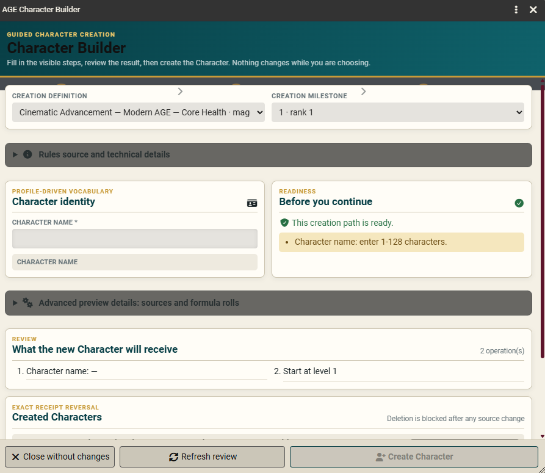
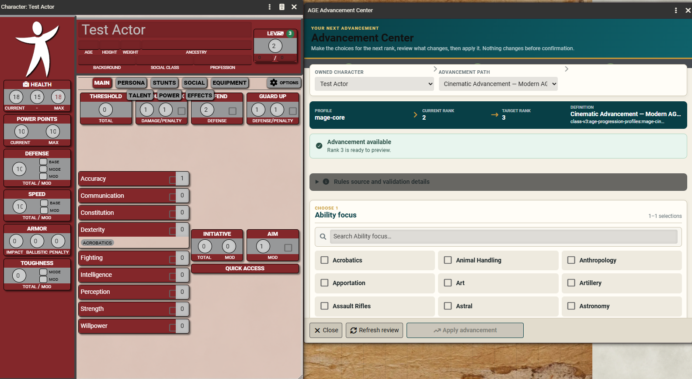
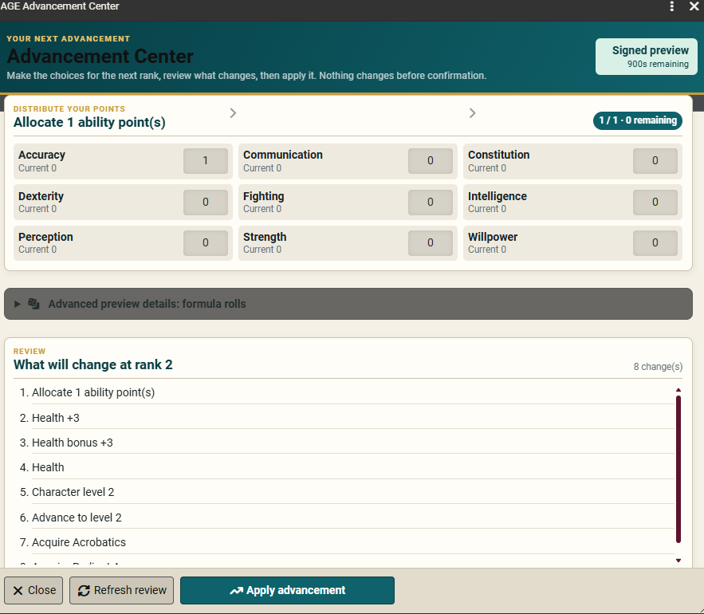
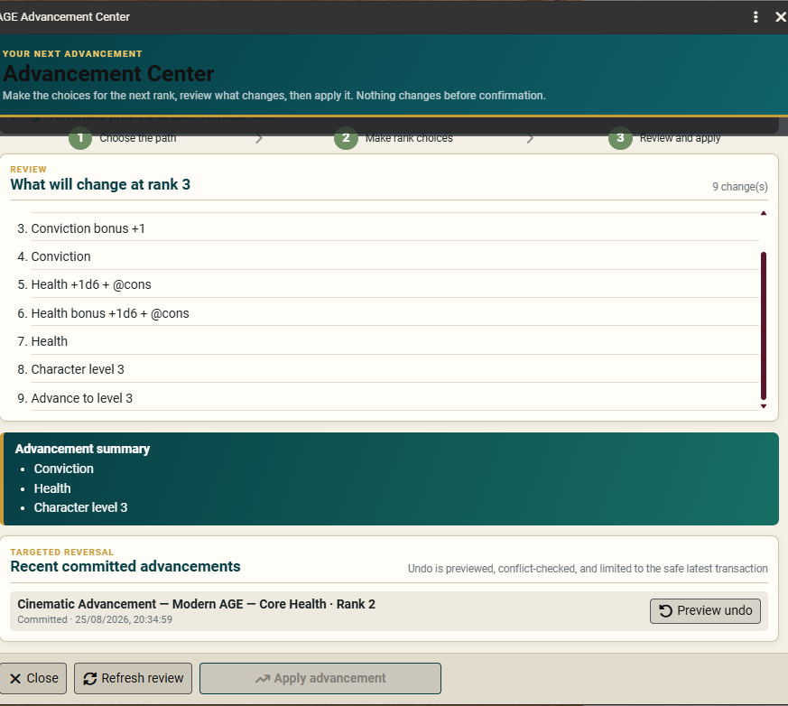
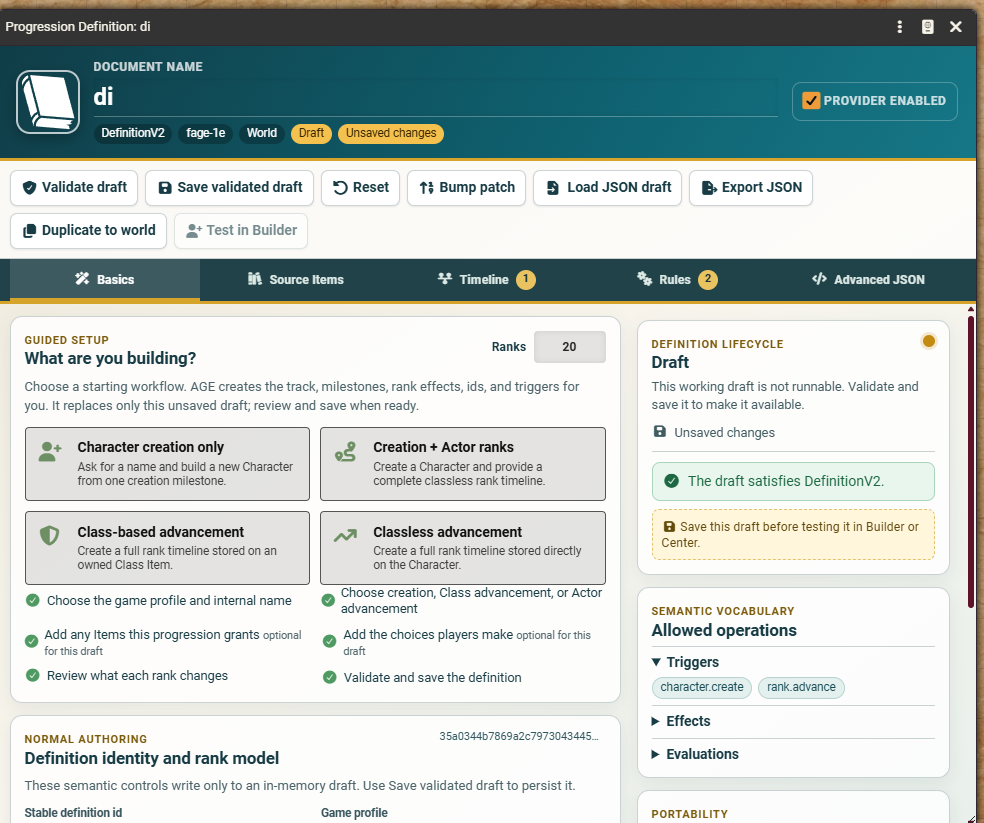
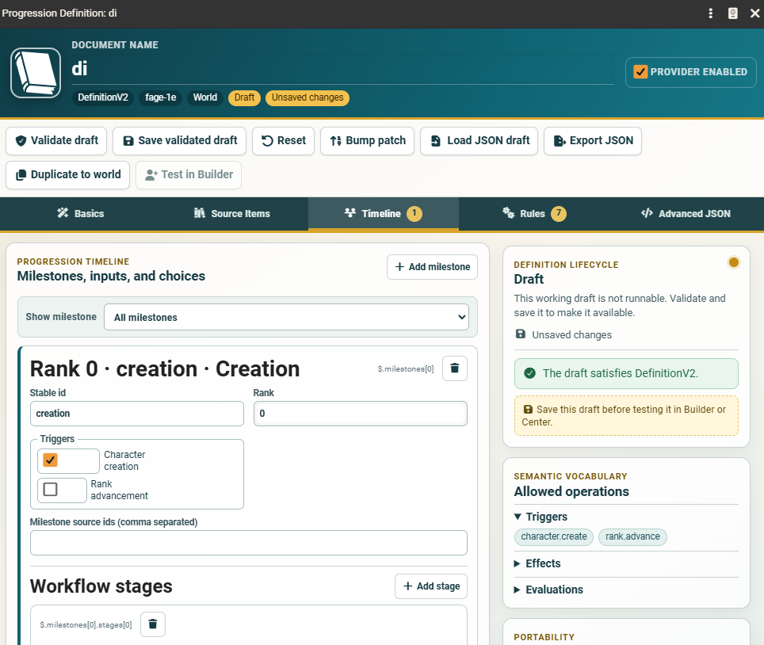

# AGE Character Creation and Advancement Handbook

This handbook is for players and Game Masters who are new to Foundry Virtual Tabletop, the AGE System, or both. It explains how to create a Character, advance one rank at a time, undo a mistaken advancement safely, and prepare your own Class or Progression Definition without editing code.

The supplied guided paths cover:

- Dragon AGE: Mage, Rogue, and Warrior.
- Fantasy AGE 1e: Mage, Rogue, and Warrior.
- Fantasy AGE 2e: Envoy, Mage, Rogue, and Warrior.
- Modern AGE: Gritty, Pulpy, and Cinematic play with either Core Health or Mastery/Injury.

> **The most important safety rule:** choosing options never changes a Character. A change happens only after the window builds a signed preview and you press **Create Character** or **Apply advancement**.

## Contents

1. [Five-minute setup](#five-minute-setup)
2. [The important words](#the-important-words)
3. [Create a Character](#create-a-character)
4. [Advance a Character](#advance-a-character)
5. [Undo safely](#undo-safely)
6. [Dragon AGE walkthrough](#dragon-age-walkthrough)
7. [Fantasy AGE 1e walkthrough](#fantasy-age-1e-walkthrough)
8. [Fantasy AGE 2e walkthrough](#fantasy-age-2e-walkthrough)
9. [Modern AGE walkthrough](#modern-age-walkthrough)
10. [GM guide: Classes and Progression Definitions](#gm-guide-classes-and-progression-definitions)
11. [Troubleshooting](#troubleshooting)
12. [Quick-reference checklists](#quick-reference-checklists)

## Five-minute setup

### What the GM installs and activates

The AGE System provides the Character sheets and progression tools. **AGE Progression Profiles** provides the ready-made game paths. A content library supplies the Focuses, Talents, Powers, equipment, and other Items those paths grant.

AGE System and AGE Progression Profiles use a **Manual / Local** release channel. They are separate packages: neither package installs the other, neither installs a content library, and they do not update automatically. Keep the downloaded packages until the new installation has been tested.

If this is your first Foundry world:

1. Find Foundry's **User Data** folder, then stop Foundry and back up any existing AGE world.
2. Extract or copy the AGE System package into `Data/systems/age-system`. Check that the manifest is directly at `Data/systems/age-system/system.json`, not inside an extra nested folder.
3. Extract or copy AGE Progression Profiles into `Data/modules/age-progression-profiles`. Check that its manifest is directly at `Data/modules/age-progression-profiles/module.json`.
4. Install the content library for your game separately under `Data/modules/<its-module-id>`, following that library's own instructions.
5. Start Foundry. Create a world and select **AGE System** as its Game System, or open an existing AGE world.
6. Enter the world as GM, open **Game Settings → Manage Modules**, and enable AGE Progression Profiles and the content library.
7. Reload the world when Foundry asks.

When a newer Manual / Local package is released, stop Foundry, take a backup, and replace the corresponding local package with the new one. Do not expect Foundry, AGE System, or AGE Progression Profiles to download that update for you.

Use the following combination:

| Game | Rule profile to apply | Content library | Advancement track |
|---|---|---|---|
| Dragon AGE | Dragon AGE | Dragon AGE Compendia | Class Item |
| Fantasy AGE 1e | Fantasy AGE 1e | No dedicated recommended library; AGE uses exact available Items and lists unmapped rules for manual review | Class Item |
| Fantasy AGE 2e | Fantasy AGE 2e | Fantasy AGE 2e Compendium | Class Item |
| Modern AGE | Modern AGE Core or Modern AGE Mastery/Injury | Modern AGE Core Library | Character itself |

If a required library is inactive or an Item is missing, AGE stops before making changes and tells you which content is unavailable.

### Apply the correct rule profile

Only the GM can change the world's rule profile.

1. Open **Game Settings**.
2. Choose **Configure Settings**.
3. Open the **System Settings** tab.
4. Set **AGE Automation** to **Assist** if it is Off.
5. Find **AGE Rule Profiles** and press **Configure Rule Profiles**.
6. Select the game you are about to play.
7. Review the **Current** and **Proposed** columns.
8. Press **Apply Profile**.

The profile controls the world's AGE vocabulary and sheet rules: abilities, Race or Ancestry, Class or Profession, Health model, wealth, Power Point naming, and related options. It does not create a Character and it is not an advancement path.

For Modern AGE, applying either Modern profile begins with Pulp settings. If the campaign is Gritty or Cinematic, open **Advanced AGE Settings** afterward and change **Game Mode**. The progression path called **Pulpy** is the Pulp rules mode.

### Back up before a new campaign or major change

Use Foundry's normal world backup before installing a new system/module version, changing a long-running world's rule profile, or testing a new homebrew progression. Test new definitions on a disposable Character first.

## The important words

| Word | Plain-language meaning |
|---|---|
| **Character** | The Foundry Actor and Character sheet used by a player or GM. |
| **Item** | A reusable rules object such as a Focus, Talent, Power, weapon, Class, or Progression Definition. |
| **Rule profile** | The selected AGE rules dialect for the whole world. |
| **Class** | For Dragon AGE and Fantasy AGE, the Item on a Character that identifies the class path and stores its class rank. |
| **Progression Definition** | The recipe that tells Character Builder or Advancement Center which questions to ask and what the result changes. |
| **Rank stored on the Class** | Dragon AGE and Fantasy AGE advancement. The Character's owned Class holds the progression rank. The editor may call this `class-item` storage. |
| **Rank stored on the Character** | Classless advancement such as Modern AGE. The Character itself holds the progression rank. The editor may call this `actor` storage. |
| **Milestone** | One usable point in a definition: Character creation or one particular rank. |
| **Choice** | A visible question such as Ancestry, Background, Focus, Talent, or ability-point allocation. |
| **Manual-review notice** | A rule the system can identify but cannot apply safely. The player and GM finish it from the rulebook. It is not an error. |
| **Signed preview** | A temporary, read-only plan containing the exact choices, changes, and formula results that will be committed. |
| **Receipt** | The saved record of a completed creation or advancement. It allows a targeted safety check before reversal. |

### Class versus Progression Definition

These are related, but they are not interchangeable.

| Class Item | Progression Definition |
|---|---|
| Lives on a Dragon AGE or Fantasy AGE Character after creation. | Lives in the world or a compendium, not inside a Character. |
| Holds the Character's class rank and class advancement schedule. | Supplies the guided questions, preview, path matching, and safe transaction. |
| One Character should have one progression-managed Class. | A world may have many definitions, but only compatible active ones are offered. |
| An owned Class is locked against casual editing. | A GM edits an editable world definition in Definition Studio. |

Modern AGE is classless. Its chosen definition stores the rank directly on the Character, so no artificial Class Item is needed.

## Create a Character

### Open Character Builder

1. Look at Foundry's controls on the left side of the canvas.
2. Open **AGE Roller** / **AGE Toolbox**.
3. Press the user-plus button titled **AGE Character Builder**.

The button is visible to GMs and to players who have Foundry permission to create Actors. If a player cannot see it, the GM can create the Character or grant the appropriate Actor creation permission.

*Example: the Builder explains why Create Character is not ready and leaves the button disabled.*

### Work through the Builder

1. Select a **Creation definition**. For class-based games, this is also how you choose Mage, Rogue, Warrior, or Envoy.
2. Leave the offered **Creation milestone** selected unless the GM has authored a special alternative.
3. Enter every required identity field. Required fields have an asterisk.
4. Work down through the named stages. Later questions may appear only after an earlier answer makes them relevant.
5. Follow each choice heading exactly. A card that says **1–1 selections** needs exactly one answer.
6. In **Distribute your points**, continue until the counter says **0 remaining**.
7. Use Search for large Focus, Talent, Background, or equipment lists. **Selected only** and **Clear** are filters; they do not secretly alter the Character.
8. Read any disabled option's explanation. It may be unavailable because of an earlier choice, a prerequisite, or an already-owned Item.
9. Press **Refresh review** when the footer asks for it.
10. Read **What the new Character will receive**, formula results, the summary, and every manual-review notice.
11. When the footer says the signed preview is ready, press **Create Character**.

Formula rolls are made when the preview is built and then pinned. Pressing Create Character uses those exact results; it does not roll again. A preview has a countdown. If it expires, press **Refresh review** and inspect the new preview.

### After creation

Open the new Character from the Actors Directory and check:

- name and identity fields;
- Class, Background, Race/Ancestry, Profession, or Drive;
- ability values and primary-ability markers;
- Health and other resources;
- Focuses, Talents, Powers, specializations, and equipment;
- every manual item listed in the preview.

The system will not guess a rule that could not be mapped safely. Finish those explicit manual items with the GM before play.

## Advance a Character

### Open Advancement Center

Open the Character and press the rising-arrow button beside **Level**. On a class-based Character, opening the owned Class also shows **Open Advancement Center**.

*Example: the current and target rank are shown before any change is made.*

### The three advancement steps

#### 1. Choose the path

1. Confirm the correct **Owned Character**.
2. For Dragon AGE or Fantasy AGE, confirm the **Owned Class**.
3. Confirm the **Advancement path**.
4. Check the strip showing Profile, Current rank, Target rank, and Definition.
5. Look for **Advancement available**.

The Center offers only the next rank. It does not skip levels.

#### 2. Make rank choices

1. Complete every visible choice group.
2. Spend every ability point until the remaining counter reaches zero.
3. If **Reuse or improve owned Items** appears, select the exact owned Focus, Talent, specialization, or Relationship to improve.
4. Do not select an already-owned Focus in a choice that only grants a new Focus. Choose another Focus unless the rank specifically offers improvement.
5. Press **Refresh review** after the choices are complete.

#### 3. Review and apply

Read **What will change at rank N** from top to bottom. Check the formula results and Advancement summary. Manual-review notices remain part of the result and must be resolved with the GM.

*Apply advancement becomes available only after all choices are complete and the preview is current.*

Press **Apply advancement** only when the preview is correct. Reopen the Character afterward and verify the new Level, resources, abilities, Focuses, Talents, and other grants.

## Undo safely

### Undo an advancement

1. Reopen Advancement Center for the Character.
2. Scroll to **Recent committed advancements**.
3. Find the newest entry with an enabled **Preview undo** button.
4. Press **Preview undo**.
5. Read the conflict check.
6. Confirm **Undo Advancement**.

Only the latest safe progression transaction can be reversed. If a later change touched something managed by that advancement, undo stops instead of overwriting the later work. Ordinary later damage or resource use is preserved when it does not conflict with the managed result.

If you may need to undo, do it before another advancement and before manually editing advancement-managed abilities, bonuses, weapon groups, or granted/improved Items. Never delete or edit an advancement-granted Item before attempting its reversal.

Do not work around a blocked undo by deleting the Class or typing a lower Level. Ask the GM to review the conflict.

### Reverse a mistaken Character creation

Character creation uses a different and destructive action:

1. Reopen Character Builder.
2. Find the created Character under **Created Characters**.
3. Press **Preview exact deletion**.
4. Confirm only if that Character should be permanently deleted.

Exact deletion is available only while the new Character still matches its creation receipt. Any later edit blocks it, protecting subsequent work.

## Dragon AGE walkthrough

Choose the **Dragon AGE** rule profile and activate Dragon AGE Compendia. The supplied routes are Mage, Rogue, and Warrior. The chosen creation definition determines the Class.

### Dragon AGE creation

#### 1. Name and concept

Enter the Character name. Concept, goals, and ties are optional notes.

#### 2. Abilities

Choose a method, then enter all eight values before the Background increase:

- roll eight scores in order and swap any two;
- roll eight scores and arrange them freely;
- spend 10 points, starting at 0, with a maximum of 3 before Background.

The Builder records the method. For a rolling method, make the rolls and type the agreed results; the method selector does not roll them silently.

#### 3. Background

Choose the combined Background, ancestry, and required Focus option. Only combinations available to the selected Class appear. Then complete the language choices and select one legal Background benefit bundle that spends exactly three points.

The Builder applies the Background identity, ancestry, Background ability increase, required Focus, languages, and representable benefits.

#### 4. Class

- **Mage:** choose Chirurgy, Linguistics, or Lore, then choose exactly three starting spells.
- **Rogue:** choose Contacts, Scouting, or Thievery.
- **Warrior:** choose two weapon-style Talents and three additional weapon groups. Weapon and Shield Style also grants the matching shield.

#### 5. Equipment

- Mage chooses one weapon.
- Rogue chooses two weapons.
- Warrior chooses three weapons from known groups.

Matching arrows or bolts are added for a selected bow or crossbow. Backpack, waterskin, and fixed class equipment are automatic. Traveling clothes and the quiver itself remain manual reminders.

#### 6. Review starting values

| Class | Starting resources and notable automatic grants |
|---|---|
| Mage | Health `20 + Constitution + 1d6`; Mana `10 + Magic + 1d6`; Cunning/Magic/Willpower primary; Brawling and Staves; Arcane Lance and Quarterstaff. |
| Rogue | Health `25 + Constitution + 1d6`; Communication/Dexterity/Perception primary; Bows, Brawling, Light Blades, and Staves; Backstab, Rogue's Armor, and Light Leather. |
| Warrior | Health `30 + Constitution + 1d6`; Constitution/Dexterity/Strength primary; Brawling; Armor Training and Heavy Leather. |

All three begin with the chosen level-1 Class and starting currency `50 + 3d6`.

### Dragon AGE advancement

Every rank after 1 grants one ability point, one eligible Focus, and Health. Ranks 2–10 use `1d6 + Constitution`; ranks 11–20 use Constitution. Mage also gains Mana: `1d6 + Magic` through rank 10, then Magic.

Even ranks use primary abilities and their Focuses; odd ranks use secondary abilities and their Focuses:

| Class | Primary at even ranks | Secondary at odd ranks |
|---|---|---|
| Mage | Cunning, Magic, Willpower | Communication, Constitution, Dexterity, Perception, Strength |
| Rogue | Communication, Dexterity, Perception | Constitution, Cunning, Magic, Strength, Willpower |
| Warrior | Constitution, Dexterity, Strength | Communication, Cunning, Magic, Perception, Willpower |

From rank 11, a Focus choice may improve an eligible owned Focus. When asked, select that Focus under **Reuse or improve owned Items**.

Common class milestones include new Talents, specializations at ranks 6 and 14, and specialization improvements at ranks 8, 10, 16, and 18. Mage also receives scheduled spell choices; Warrior receives scheduled weapon-group choices; fixed Class powers appear at their listed ranks.

The GM still checks printed prerequisites, manual class-feature text, and any result the preview explicitly marks for review.

## Fantasy AGE 1e walkthrough

Choose the **Fantasy AGE 1e** profile. The supplied routes are Mage, Rogue, and Warrior. First-edition material sometimes has no exact safe Item in an installed mixed-edition library; those cases intentionally appear as manual-review notices.

### Fantasy AGE 1e creation

#### 1. Name, goals, and ties

Enter the Character name and describe at least one short-term and one long-term goal. Ties and relationships are optional.

#### 2. Abilities

Spend exactly 10 points among the nine abilities. Every ability starts at 0, and no ability may receive more than 3 points before Race benefits. The guided route must spend all 10 points.

The source's rolling alternative is a GM-managed option; this guided route uses the unambiguous point-buy method.

#### 3. Race

Choose Dwarf, Elf, Gnome, Halfling, Human, or Orc. Then choose the Race's starting Focus and two distinct benefit results matching the 2d6 rolls, unless the GM has approved free choice.

| Race | Fixed ability | Starting Focus choices |
|---|---|---|
| Dwarf | Constitution +1 | Drinking or Evaluation |
| Elf | Dexterity +1 | Natural Lore or Seeing |
| Gnome | Dexterity +1 | Stamina or Legerdemain |
| Halfling | Dexterity +1 | Bargaining or Stealth |
| Human | Fighting +1 | Riding or Swimming |
| Orc | Strength +1 | Stamina or Might |

Some results, such as Drinking, Race Speed, a duplicate Focus, or a weapon-group result that depends on the final Class, require manual review.

#### 4. Social class and Background

Match Social Class and Background to the indicated 1d6 results unless the GM permits free choice, then choose one exact Background Focus.

| Social class | Starting silver | Available Backgrounds |
|---|---:|---|
| Outsider | `15 + 3d6` | Criminal, Exile, Hermit, Pirate, Radical, Wanderer |
| Lower Class | `25 + 3d6` | Artist, Laborer, Performer, Sailor, Soldier, Tradesperson |
| Middle Class | `50 + 3d6` | Guilder, Initiate, Innkeeper, Merchant, Scribe, Student |
| Upper Class | `100 + 3d6` | Apprentice, Dilettante, Noble, Official, Scholar, Squire |

#### 5. Class

- **Mage:** choose two starting Arcana and one of Chirurgy, Linguistics, or Lore. Brawling, Staves, and Arcane Device are automatic. First-edition spell details identified in the review remain manual.
- **Rogue:** choose Bows or a campaign-approved Black Powder group, then Contacts, Scouting, or Thievery. Brawling, Staves, and Light Leather are automatic; Light Blades and some first-edition class features are manual.
- **Warrior:** choose three weapon groups and two weapon-style Talents. Brawling and Heavy Leather are automatic. The preview identifies any style or training details that need a first-edition manual check.

#### 6. Equipment

Backpack, traveler's garb, waterskin, and exact class equipment are automatic. Starting weapons remain manual because their legality depends on the final weapon groups:

- Mage: one weapon.
- Rogue: two weapons.
- Warrior: three weapons.

Add a quiver and 20 arrows or bolts only when a matching bow or crossbow is selected.

#### 7. Review

Treat the review as a checklist. Resolve Race Speed, mixed heritage, duplicate Focus results, Drinking, multiword weapon groups, Talent prerequisites, starting weapons, ammunition, and any first-edition Class or spell notice before play.

### Fantasy AGE 1e advancement

Every rank after 1 grants one ability point, one eligible Focus, and Health. Ranks 2–10 use `1d6 + Constitution`; later ranks use Constitution. Mage also gains Magic Points: `1d6 + Willpower` through rank 10, then Willpower.

| Class | Primary at even ranks | Secondary at odd ranks |
|---|---|---|
| Mage | Accuracy, Intelligence, Perception, Willpower | Communication, Constitution, Dexterity, Fighting, Strength |
| Rogue | Accuracy, Communication, Dexterity, Perception | Constitution, Fighting, Intelligence, Strength, Willpower |
| Warrior | Constitution, Dexterity, Fighting, Strength | Accuracy, Communication, Intelligence, Perception, Willpower |

From rank 11, an eligible owned Focus can be improved. New specializations appear at ranks 4 and 12; owned specializations advance at ranks 6, 8, 14, and 16. Other Talent and Class-power choices appear at their scheduled ranks.

The GM enforces the campaign's legal first-edition specialization list, prerequisites, weapon-group reminders, and any signed manual notice.

## Fantasy AGE 2e walkthrough

Choose the **Fantasy AGE 2e** profile and activate the Fantasy AGE 2e Compendium. The supplied creation definitions are Envoy, Mage, Rogue, and Warrior.

### Fantasy AGE 2e creation

#### 1. Name

Enter the Character name.

#### 2. Abilities

Spend exactly 13 points among the nine abilities. All abilities begin at 0, and no ability may receive more than 3 points before Ancestry benefits. The guided route uses this complete point-buy method.

#### 3. Ancestry

Choose an Ancestry. Then complete only the follow-up cards that appear:

- choose the starting Focus where required;
- choose either one ability increase or the two-benefit-results route;
- if using benefit results, complete both slots.

Some table outcomes remain manual when the source rule cannot be represented safely.

#### 4. Background

Search for and select one Background, then choose one of its eligible Focuses. The definition records Background and Social Class and prepares starting silver from that source entry.

#### 5. Class

Complete the starting specialization, Talent, spell, and weapon-group choices shown for the definition selected at the top.

| Class | Primary abilities | Main starting choices | Starting Health |
|---|---|---|---|
| Envoy | Communication, Fighting, Intelligence, Willpower | Two Talents, a specialization, and three weapon groups | `25 + Constitution + 1d6` |
| Mage | Accuracy, Intelligence, Perception, Willpower | One regular Talent, two spell Talents, and a specialization | `20 + Constitution + 1d6` |
| Rogue | Accuracy, Communication, Dexterity, Perception | One Talent, a specialization, and two additional weapon groups | `25 + Constitution + 1d6` |
| Warrior | Constitution, Dexterity, Fighting, Strength | Two weapon-style Talents, a specialization, and four additional weapon groups | `30 + Constitution + 1d6` |

Mage also receives starting Magic Points of `10 + Willpower + 1d6`.

#### 6. Equipment

Fixed equipment is automatic. Select conditional supplies only when they apply: ammunition, black-powder supplies, a shield for Weapon and Shield Style, or Technofantasy supplies.

Starting weapon selection remains a signed manual reminder. Add the agreed weapon Items after creation.

#### 7. Review

Verify identity, abilities, primary markers, Health, Magic Points, Focuses, Talents, specialization, Powers, equipment, starting silver, and all manual notices. Refresh, then create.

### Fantasy AGE 2e advancement

1. Confirm the Character, owned Class, and path.
2. Allocate the required ability point.
3. Choose the offered Focus.
4. Choose or advance the Talents, class stunts, and specialization shown for the level.
5. Select an owned Item when the Center asks what to improve.
6. Refresh, review, and apply.

The normal schedule gives one ability point at every level after 1. Focuses alternate between primary abilities at even levels and secondary abilities at odd levels. Health uses `Constitution + 1d6` through level 10 and Constitution afterward.

Mage receives spell-Talent advancement at even levels and non-magical Talent advancement at levels 4, 8, 12, 16, and 20. Other Classes receive Talent advancement at even levels. Specialization advancement appears at odd levels. Envoy receives an additional any-ability Focus at levels 4, 8, and 12.

The GM still checks prerequisites, campaign source permissions, weapon-group reminders, manual equipment, minimum resource-roll rules, and duplicate Focuses.

## Modern AGE walkthrough

Modern AGE needs two choices before creation:

1. Apply **Modern AGE Core** for standard Health or **Modern AGE Mastery/Injury** for Injury tracking.
2. In Advanced AGE Settings, confirm **Gritty**, **Pulp**, or **Cinematic** Game Mode.

Select the creation definition whose name matches both choices. **Pulpy** in a definition name means Pulp mode.

Modern AGE stores the rank and chosen route on the Character itself. Choose carefully: another definition cannot silently take over that same progression later.

### Modern AGE creation

#### 1. Name

Enter the Character name.

#### 2. Abilities and Conviction

Select the agreed method:

- Ordered 3d6.
- Arranged 3d6 with GM permission.
- 12-point buy with GM permission.

Enter the final value for all nine abilities. The Builder records the method but does not perform or validate the tabletop rolling, swapping, or spending procedure. Choose whether optional Conviction is used; when enabled, it starts at 3.

#### 3. Social Class

Choose Outsider, Lower Class, Middle Class, or Upper Class.

#### 4. Background

Only Backgrounds belonging to the selected Social Class appear. Choose:

- one Background;
- its Focus;
- its Talent;
- one Extra Benefit.

The Background also applies its fixed ability increase.

#### 5. Profession

Choose one eligible Profession, one Profession Focus, and one Profession Talent. Profession initializes Resources. With Core Health, it also initializes Health from the Profession base plus Constitution. Mastery/Injury does not initialize standard Health.

#### 6. Drive

Choose one Drive, its novice Talent, and one Drive Improvement. The Drive records its Quality and Downfall. An improvement may add Health, Resources, Membership, a Relationship, or a manual Reputation reminder.

Under Mastery/Injury, a Health improvement remains a manual-review instruction rather than changing standard Health.

#### 7. Relationships

Choose at least one Relationship template. The first slot is required. Use no more than `max(1, final Communication)` Relationship slots, up to the four visible slots. The player and GM verify this limit.

#### 8. Review

Verify abilities, Conviction, identity, Background, Profession, Drive, Relationships, Resources, Health/Injury treatment, and all manual notices. Refresh, then create.

### Modern AGE advancement

There is no Owned Class selector. At every level after 1:

1. Allocate one ability point.
2. Choose one Focus.
3. Choose a new Talent or improve an owned Talent.
4. Complete any specialization or Relationship choice shown.
5. Refresh, review, and apply.

Focus and Talent choices appear at every level. From level 11, a Focus may be improved. Specializations advance at levels 4, 6, 8, 12, 14, and 16. Relationship choices appear at levels 4, 8, 12, 16, and 20. Conviction gains appear at odd levels after 1; ignore them when the optional Conviction rule is disabled.

| Mode | Health | Defense and Toughness | Resources |
|---|---|---|---|
| Gritty | No level-based Health increase | No level-based increase | Improve only through GM awards |
| Pulpy | `1 + Constitution` each level | At 4, 8, 12, 16, and 20 choose Defense or Toughness, alternating | Restore one depleted point manually per level |
| Cinematic | Levels 2–10: `1d6 + Constitution`; levels 11–20: `1 + Constitution` | Both increase at 4, 8, 12, 16, and 20 | Increase by 1 manually after each level beyond 1 |

The player and GM also check consecutive ability/Focus restrictions, Relationship limits, Pulpy Defense/Toughness alternation, manual Resources changes, and any option labelled manual.

## GM guide: Classes and Progression Definitions

Only a GM can create or edit Progression Definitions. A definition must be a top-level Item in the world or a compendium; it cannot be owned by a Character.

### Choose the easiest authoring route

For most campaigns, do not begin with a blank document. Open **Compendium Packs → AGE Progression Definitions**, find the closest supplied route, open it, and press **Duplicate to world**. The source compendium stays unchanged, and the world copy opens for editing.

A Class sheet does not have that button. Open the appropriate progression Class pack and drag or import the closest Class into the **Items Directory**, then edit that top-level world copy. This preserves a known-good structure and makes omissions much easier to spot.

Copying both documents does not connect them automatically. If you customize an imported supplied Class:

1. In the copied creation definition, open **Source Items** and replace the supplied Class source with the new world Class. Confirm that the creation effect which grants the Class selects that source.
2. In the copied advancement definition, open **Basics → Track binding** and keep Storage as `class-item`. Keep the original supplied compendium Class UUID in **Allowed Class source UUIDs**; the imported world copy normally retains that stable origin. You may include both the original compendium UUID and the world copy's UUID, separated by a comma, but do not replace the original with only the world UUID.
3. Validate and save both definitions, create a disposable Character, and confirm that the Character receives the customized Class and that Advancement Center finds its matching route.

A brand-new world Class with no compendium origin has no reliable Class-binding control in the normal sheet. For a beginner-safe definition-driven route, start from an imported supplied Class. A completely new Class can still use its own Advancement schedule, but do not publish a matching Progression Definition until a disposable created Character is recognized by Advancement Center.

### Decide what you are building

| Goal | Recommended structure |
|---|---|
| A one-time creation questionnaire | Character creation only |
| Modern AGE creation and levels | Creation + Actor ranks (rank stored on the Character) |
| Dragon AGE or Fantasy AGE class levels | One creation definition plus one Class-based advancement definition (rank stored on the Class) |
| A classless game with existing Characters | Classless advancement (rank stored on the Character) |

Dragon AGE and Fantasy AGE normally use a pair: the creation definition builds the Character and gives it the matching level-1 Class; the advancement definition stores later ranks on that owned Class. Modern AGE can use one combined definition that stores ranks directly on the Character.

### Create or edit a Class Item

Skip this section for Modern AGE.

1. Open Foundry's **Items Directory**.
2. Create an Item of type **Class** for a standalone Class schedule, or—recommended for a definition-driven route—import/drag the closest supplied Class from its compendium into the Items Directory.
3. Edit the top-level Item before placing it on a Character. Once a Class is owned by a Character, its definition is locked for safety.
4. On **Description**, explain the Class in player-facing language.
5. On **Advancement**, select the Class's primary abilities when that game uses primary and secondary abilities.
6. Add its starting weapon groups.
7. Press the plus beside **Improvements** for each part of the schedule.

Choose **Progressive Trait** for a numerical value that changes by level, such as Health, Magic/Power Points, ability advancements, or a class bonus. Select the trait, give the row a clear name, and fill the value or formula only at the levels where it applies.

Choose **New Item or Improve Existing One** for Focuses, Talents, specializations, Relationships, Powers, and similar grants:

1. Select the level.
2. Choose **Receive all Items** when every listed Item is automatic, or **Pick Items from list** when the player chooses.
3. Set how many Items must be picked.
4. Drag the allowed Items from a world directory or compendium into the drop area.
5. Enable **Improve matching owned Items** when the rule permits an existing Item to advance instead of creating a duplicate.
6. Use **Item Progression** only when the rank must advance an owned Focus, Talent, specialization, or Relationship without granting a specific new Item.
7. Confirm and repeat for later levels.

Right-click an existing Improvement to edit or delete it. Keep aliases clear because the player sees them in Advancement Center.

### Open Definition Studio

1. In the **Items Directory**, create an Item.
2. Choose type **Progression Definition**.
3. Give it a clear document name and open it.
4. Keep **Provider enabled** checked only when the path is ready for players. A work-in-progress may stay disabled.

### Build a definition step by step

#### 1. Basics

Set the intended number of ranks, then choose one guided starting point:

- **Character creation only** creates one creation milestone.
- **Creation + Actor ranks** creates Character creation and a complete classless rank timeline stored on the Character.
- **Class-based advancement** creates a rank timeline stored on an owned Class.
- **Classless advancement** creates a rank timeline stored directly on an existing Character.

Guided setup replaces only the unsaved draft and asks for confirmation first.

Choose the matching **Game profile**. Leave **Stable definition id** at its generated value unless you have a clear naming scheme. For an advancement definition, confirm that **Storage** is `class-item` for Dragon AGE/Fantasy AGE or `actor` for Modern AGE.

Once a definition has been saved, its identity and game profile stay fixed. Use **Duplicate to world** when you need a separate route.

#### 2. Source Items

Add every Item that the definition may grant:

1. Open **Source Items**.
2. Drag an Item from the sidebar or a compendium onto the source area, or search by name.
3. Repeat for Classes, Focuses, Talents, Powers, equipment, and other grants.

Add source Items before building options that use them. If a source later disappears or its compendium is disabled, preview stops safely.

#### 3. Timeline

Use the milestone filter to work on one rank at a time.

For each milestone:

1. Confirm its rank.
2. Mark **Character creation** for the creation milestone or **Rank advancement** for a level milestone.
3. Add a workflow stage when the Builder needs a visible section such as Name, Abilities, Ancestry, Background, Class, Equipment, or Review.
4. Add a text, long-text, number, or select input when the player must type a value.
5. Add a choice group when the player must pick from options.
6. Give the choice a plain label and exact minimum/maximum selection count.
7. Add the permitted options.
8. Put an **Effect** on the milestone when everyone receives it. Put an Effect on an option when only that choice receives it.

Keep each stage small and ask questions in the order the player needs them. If a later choice depends on an earlier one, test both a valid and invalid combination.

#### 4. Rules

The Rules tab holds what each milestone or option does. Common changes are:

| Desired result | Select this Effect type |
|---|---|
| Set name, Race/Ancestry, Background, Class, Profession, Drive, or similar identity | `identity.set` |
| Enter an exact starting ability value | `ability.set` |
| Let the player spend ability points | `ability.allocate` |
| Mark a primary ability | `ability.setPrimary` |
| Set starting Health, Mana, Magic Points, Conviction, Currency, or Resources | `resource.initialize` |
| Add a resource at a later rank | `resource.gain` |
| Add a language or weapon group | `language.add` / `weaponGroup.add` |
| Give a Class, Focus, Talent, Power, or equipment Item | `item.acquire` |
| Improve an owned Focus, Talent, specialization, or Relationship | `item.advance` |
| Store the new rank | `track.setRank`; guided setup already adds this |
| Tell the player about a rule that cannot be automated safely | `summary.add` |

Conditions are optional. Begin without them. Add one only when a choice truly depends on an earlier choice, an owned Item, a minimum ability, or a minimum rank. A clear manual summary is safer than guessed automation.

**Advanced JSON** is an expert import/export view. A normal GM can ignore it and use Basics, Source Items, Timeline, and Rules.

#### 5. Validate, save, and test

1. Press **Validate draft**.
2. Use the clickable issue list to return to each problem.
3. Correct every issue and validate again.
4. If the sheet asks for **Bump patch** after changing a saved route, use that button and validate again.
5. Press **Save validated draft**.
6. Confirm the lifecycle says **Valid · Active**. **Draft** is not runnable; **Valid · Disabled** is saved but hidden; **Invalid** needs correction.
7. Press **Test in Builder** for a creation route and use it to create a disposable Character.
8. For an advancement route, press **Test in Center** and select the disposable Character created for this test.
9. Advance through several different kinds of rank, including one with a formula, one with a choice, and one that improves an owned Item.
10. Test **Preview undo**.

Do not enable a definition for players until its preview says exactly what you expect.

### Game-specific authoring recipes

#### Dragon AGE

- Use one creation definition for each of Mage, Rogue, and Warrior.
- Use a matching Class-based advancement definition and Class Item for each.
- Creation should acquire the correct level-1 Class.
- Model the eight abilities, Background/ancestry package, Focus, benefit bundle, starting Talents/spells/groups, equipment, Health, Mana where applicable, and currency.
- Alternate primary and secondary ability/Focus eligibility by rank.

#### Fantasy AGE 1e

- Use one creation/advancement pair per Class.
- Model nine abilities, Race, Race benefits, Social Class, Background, Class choices, and equipment.
- Keep ambiguous mixed-edition or unmapped first-edition grants as explicit manual summaries.
- Test duplicate Focuses and every starting Class route.

#### Fantasy AGE 2e

- Use one creation/advancement pair for Envoy, Mage, Rogue, and Warrior.
- Model nine abilities, Ancestry and its benefit route, Background and Social Class, specialization, Class choices, and conditional equipment.
- Test both ancestry benefit patterns and all four Classes.

#### Modern AGE

- Store ranks directly on the Character; do not create a dummy Class.
- Build separate paths for Gritty, Pulpy, and Cinematic when their schedules differ.
- Keep Core Health and Mastery/Injury routes separate.
- Model Social Class, Background, Profession, Drive, Relationships, Resources, optional Conviction, and the selected Health model.
- Test that a Character created with one path continues on that same path.

## Troubleshooting

### Create Character or Apply advancement is grey

Read the footer first; it reports the first blocker. Then check the Readiness or Validation panel.

Common causes:

- a required name or other input is blank;
- a choice group has too few or too many selections;
- ability points remain unspent;
- an owned Item target has not been selected;
- the preview is still being prepared;
- the preview expired;
- required content is unavailable.

Complete the requirement, then press **Refresh review**.

### No creation definition is available

Ask the GM to check:

1. AGE Progression Profiles is active.
2. The relevant content library is active.
3. The matching Rule Profile is active.
4. The Progression Definition is saved, valid, enabled, and marked **Valid · Active**.

### No compatible advancement is available

For Dragon AGE and Fantasy AGE, confirm that the Character owns exactly one correct progression Class and the active profile matches it. For Modern AGE, confirm that the Character was created with the matching route stored directly on it.

Do not type over a class-managed Level field.

### Required content unavailable

Enable or restore the named module or compendium and press **Refresh review**. If it remains unavailable, the GM must replace or repair that Source Item in the definition.

### A Focus says it is already owned

An acquisition choice cannot create the same Focus twice. Choose another Focus, or use a rank option specifically written to improve an owned Focus and select the target under **Reuse or improve owned Items**.

### The preview expired or the Character changed

Press **Refresh review**. Read the rebuilt formula results because a fresh preview may contain a new roll. If the error persists after an outside Character edit, close and reopen the Center.

### Undo is unavailable

Only the latest safe transaction is eligible. A later managed change may block reversal deliberately. Do not manually subtract levels or delete the Class; ask the GM to inspect what changed.

### A manual-review notice appears

This is part of the rules result, not a system failure. AGE knows the source asks for a decision but will not guess the answer. Read the named rule with the GM and make the decision. If you may need to undo, perform that undo before making the manual follow-up; otherwise update the Character manually as required.

### A legacy advancement button appears

Use legacy advancement only for an older Class that has no compatible current definition. It is a fallback, not the normal route for the supplied current profiles.

## Quick-reference checklists

### GM campaign setup

- [ ] Back up the world.
- [ ] Create or open a world that uses AGE System.
- [ ] Activate AGE Progression Profiles.
- [ ] Activate the relevant content library.
- [ ] Set AGE Automation to Assist.
- [ ] Apply the matching Rule Profile.
- [ ] For Modern AGE, confirm Health model and Game Mode.
- [ ] Create one disposable test Character before inviting players.

### Player creation

- [ ] Open AGE Toolbox → Character Builder.
- [ ] Select the correct game/Class/mode definition.
- [ ] Complete every named stage.
- [ ] Spend all ability points.
- [ ] Refresh review.
- [ ] Read every change and manual notice.
- [ ] Create Character.
- [ ] Open the sheet and finish manual items with the GM.

### Player advancement

- [ ] Open Advancement Center from the Level arrow.
- [ ] Confirm Character, Class if shown, path, and target rank.
- [ ] Complete every choice.
- [ ] Spend all ability points.
- [ ] Select owned Items to improve when requested.
- [ ] Refresh review.
- [ ] Read formulas, changes, and manual notices.
- [ ] Apply advancement.
- [ ] Reopen the sheet and verify the result.

### GM definition publication

- [ ] Work in an editable world copy.
- [ ] Choose the correct game profile and whether rank is stored on a Class or on the Character.
- [ ] Add all Source Items.
- [ ] Review every creation/rank milestone.
- [ ] Make selection counts explicit.
- [ ] Prefer a manual summary over an uncertain effect.
- [ ] Validate the draft.
- [ ] Save the validated draft.
- [ ] Confirm Valid · Active.
- [ ] Test creation or advancement on a disposable Character.
- [ ] Test a safe undo.
